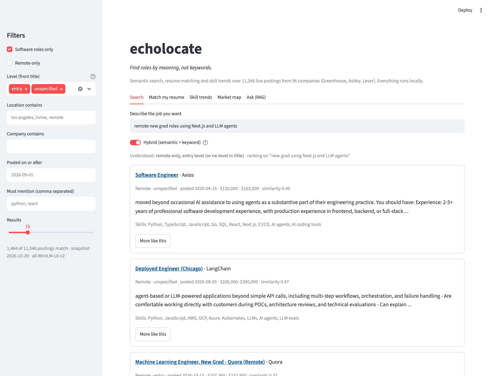
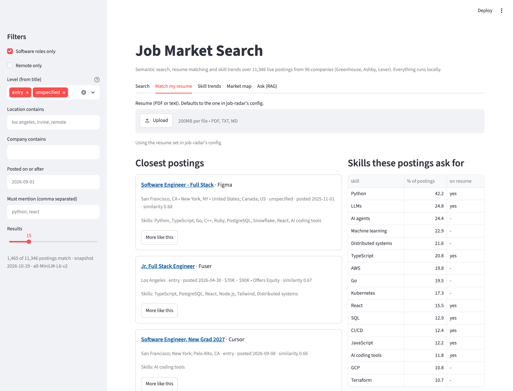
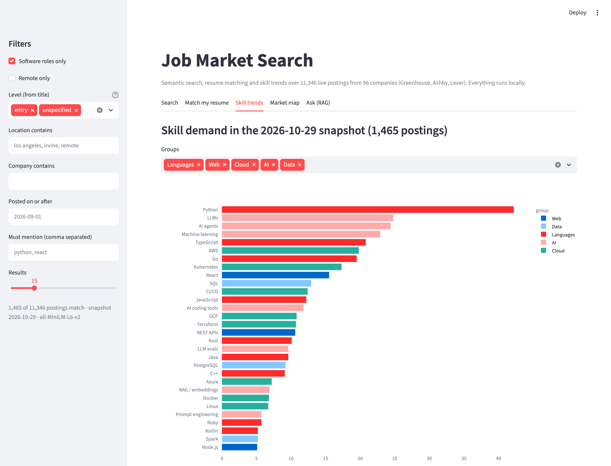
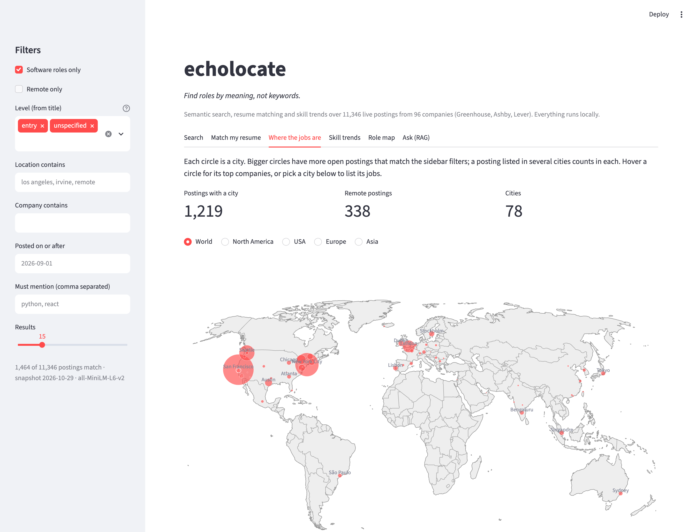
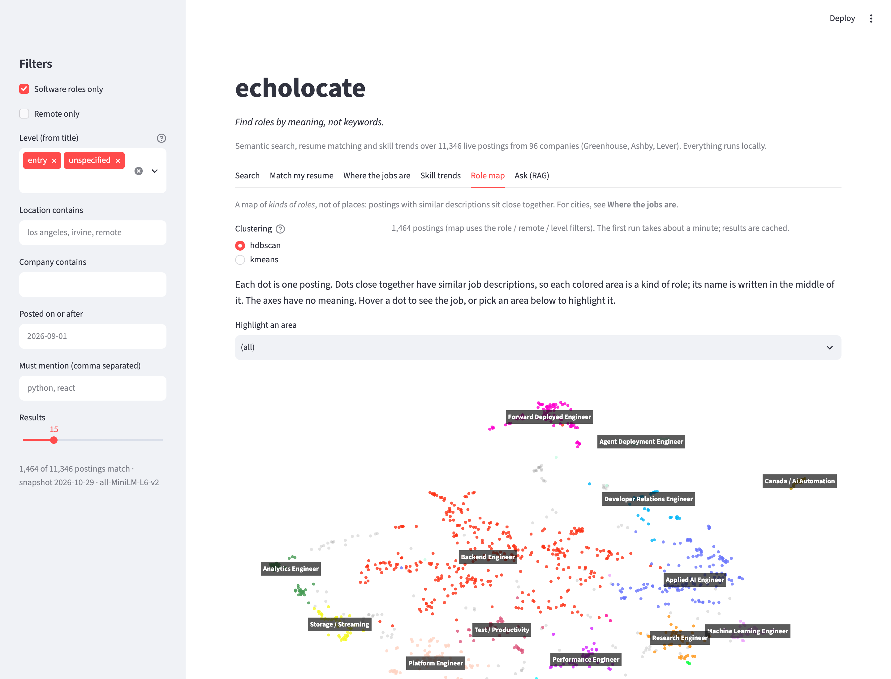
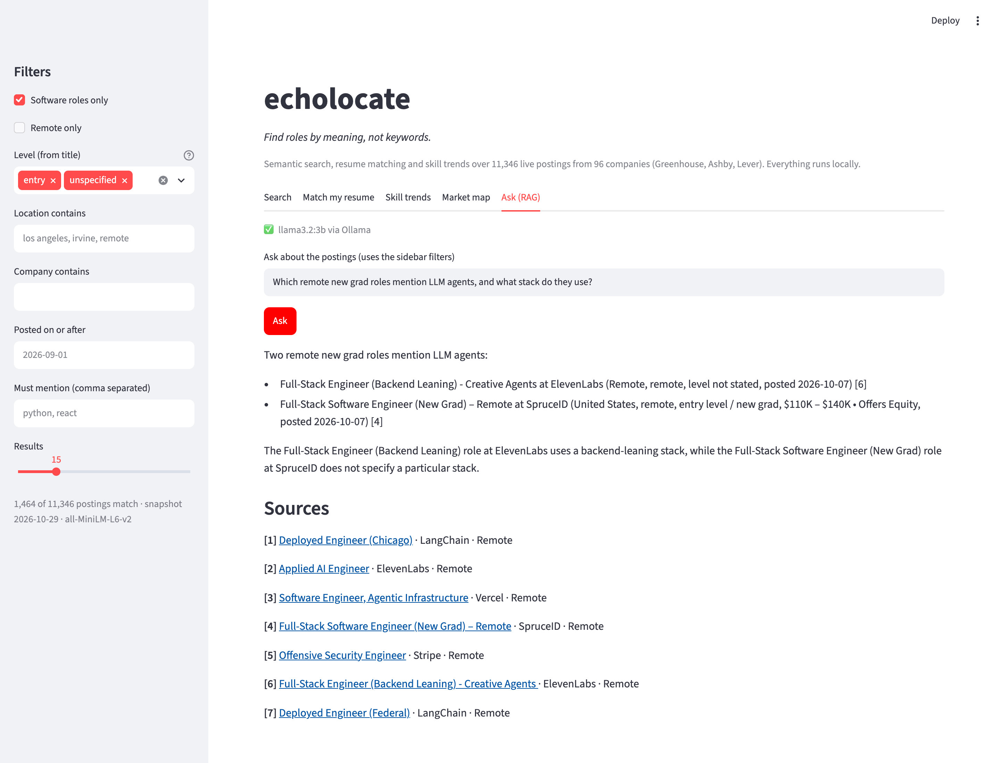

# echolocate

*Find roles by meaning, not keywords: the way a bat finds things in the dark by echo.* [job-radar](https://github.com/sophiazhangio/job-radar) sweeps the job boards; echolocate reads what it found.

Semantic search, resume matching, skill-demand trends and RAG Q&A over every job posting that my [job-radar](https://github.com/sophiazhangio/job-radar) tool pulls each day: about **11,000 live postings from ~100 tech companies** (Greenhouse, Ashby and Lever public job boards).

**Live site: [echolocate.streamlit.app](https://echolocate.streamlit.app/)**, updated every morning for software and IT jobs (a free CPU server: the first visit after a quiet spell takes a minute to wake up, and RAG answers need Ollama locally).

Everything runs on a laptop. No paid APIs or API keys: embeddings come from `sentence-transformers` (all-MiniLM-L6-v2), the vectors live in SQLite + NumPy, and answers come from a local Llama 3.2 3B model through [Ollama](https://ollama.com).



## What it does

| | |
|---|---|
| **Natural-language search** | "remote new grad roles using Next.js and LLM agents". Hybrid retrieval: embedding similarity and TF-IDF keyword ranking merged with reciprocal rank fusion, so meaning and exact names like *Next.js* both count. Filters for remote, seniority, location, company, date and must-have terms. |
| **Match my resume** | Ranks postings by similarity to a resume PDF, and lists the skills those postings ask for with a check for the ones the resume already shows. |
| **More like this** | Nearest neighbours of any posting (re-posts of the same role in other cities are skipped). |
| **Skill trends** | Share of postings that mention each of ~55 skills, per daily snapshot, plus a publish-month view that works from a single snapshot. |
| **Where the jobs are** | World / US map of open postings by city, from free-text locations ("NY or SF; US", "Portland, OR") resolved offline against GeoNames; pick a city to list its jobs. |
| **Role map** | A map of *kinds of roles*, not places: UMAP projection of every posting, clustered with HDBSCAN (or KMeans), each area named after its most common specific job title. |
| **Ask (RAG)** | Answers questions from the retrieved postings only, with numbered citations that link to each posting. |

## How it works

```
job-radar (TypeScript)                     echolocate (Python)
  npm run scan -- --dump                     python -m echolocate index
  └─ out/all/2026-10-29.jsonl  ───────────▶  ├─ ingest: upsert postings, record daily snapshot,
     one posting per line                    │          tag level, role family and skills
                                             ├─ strip company boilerplate, chunk (~100 words)
                                             ├─ embed chunks (MiniLM, 384-d, float16 in SQLite)
                                             └─ only new or changed postings are re-embedded

  query ─▶ embed ─▶ cosine vs every chunk ─▶ best chunk per posting ─┐
        └─▶ TF-IDF over title + description ─────────────────────────┴─▶ RRF ─▶ filters ─▶ top k
                                                                                    └─▶ Llama 3.2 (Ollama) ─▶ cited answer
```

Some choices worth calling out:

- **Chunk-level retrieval.** A posting averages ~940 words, but MiniLM reads about 128 word pieces. Each posting is split into overlapping ~100-word chunks, and each chunk starts with "*title* at *company*:" so it keeps its context. A posting scores as its best chunk, and the snippet shown is that chunk.
- **Boilerplate removal before embedding.** A long line (20+ words) that repeats in 5+ postings of the same company is almost always "About us", benefits or EEO text. Dropping those lines removed **~45% of the words** to embed and stops benefit paragraphs from matching queries. Short repeated lines are kept because they are often real requirements. Keyword search still uses the full text; skill counts use the stripped text, so a company blurb like "the leading platform for AI agents" does not count as every posting asking for AI agents.
- **Hybrid ranking with RRF.** Embeddings understand "frontend" ≈ "UI engineer" but blur exact technology names; TF-IDF does the opposite. Reciprocal rank fusion (`1 / (60 + rank)`, summed) combines them without tuning score scales. See [Evaluation](#evaluation).
- **Incremental indexing.** Each posting's stripped text is hashed; a daily run only embeds postings that are new or changed. Snapshots keep which postings were live on which day, which is what the trend charts use.
- **Query understanding.** "remote", "new grad", "intern" in a query become filters (shown as *Understood: remote only, entry level*), because embeddings treat them as soft hints and happily rank an on-site senior role first.
- **One row per role.** The same role posted for five cities is shown once with "+4 more locations".
- **Company centering for the map.** Every posting from one company shares its vocabulary, so raw vectors cluster by employer. Subtracting each company's mean vector leaves what is specific to the role.
- **Clustering in 10-d, drawing in 2-d.** HDBSCAN runs on a 10-dimensional UMAP projection (density clustering struggles in 384 dimensions); a separate 2-d projection is used only for the picture. Cluster names come from class-based TF-IDF over job titles.
- **Grounded answers.** The RAG prompt gives the model at most two chunks per posting as numbered sources, tells it to answer only from them and cite `[n]`, and runs at temperature 0.1.

## Evaluation

There are no human relevance labels for job postings, so [`evaluate.py`](echolocate/evaluate.py) pairs 15 queries with a rule that marks a posting relevant (for example *"data engineer building pipelines with Spark and Airflow"*: title contains "data" **and** the description mentions Spark or Airflow). Precision@10 on the 2026-10-29 snapshot (11,346 postings):

| Retriever | Mean P@10 |
|---|---|
| Dense (MiniLM embeddings, best chunk) | 0.81 |
| Keyword (TF-IDF) | 0.86 |
| **Hybrid (RRF of both)** | **0.89** |

Where each one wins:

| Query | Dense | Keyword | Hybrid |
|---|---|---|---|
| data engineer building pipelines with Spark and Airflow | 0.20 | 0.80 | 0.80 |
| engineer building LLM agents and retrieval-augmented generation | 0.60 | 1.00 | 0.80 |
| backend engineer writing services in Go | 0.80 | 0.40 | 0.70 |
| embedded firmware engineer | 0.90 | 0.60 | 0.80 |
| frontend engineer building React and TypeScript user interfaces | 0.60 | 0.70 | 0.80 |
| machine learning engineer training PyTorch models | 0.80 | 0.90 | 1.00 |

Embeddings miss exact tool names (Spark, Airflow); keywords fail on short ambiguous terms ("Go") and on paraphrase. The fused ranking is never the worst of the three and is the best on average. The rules are keyword-based, which flatters the keyword retriever a little, so read this as a sanity check rather than a benchmark.

Two other checks that changed the design:

- **Role map before and after company centering.** Without it, the average share of a cluster's largest company was 81% (clusters were "Stripe", "Roblox", "Cloudflare"). With it, 28%, and clusters read as role types: applied AI / agents, storage & databases, security, frontend, forward-deployed, payments, mobile, SRE.
- **Grounding.** An early RAG answer called London roles "remote" because the question's "remote" was only used for similarity. Now the same query parser that powers search turns "remote" / "new grad" into hard filters before retrieval, and each source tells the model its level.

## Setup

Needs Python 3.10+ and a job-radar checkout next to this folder (`../job-radar`) that has run at least once with `--dump`.

```bash
git clone https://github.com/sophiazhangio/echolocate
cd echolocate
python3 -m venv .venv && source .venv/bin/activate
pip install -e ".[dev]"

# in ../job-radar: write the full dump (or set "dump": true in its config.local.json)
npm run scan -- --dump

python -m echolocate index     # first run downloads MiniLM (~90 MB) and embeds everything
streamlit run app.py                  # open http://localhost:8501
```

The first index of ~11k postings (81k chunks) takes about 18 minutes on an M1 Pro CPU; later runs only embed the day's new postings.

For the **Ask** tab, install Ollama and pull a small model (~2 GB):

```bash
brew install --cask ollama-app   # or download from ollama.com
ollama pull llama3.2:3b
```

### Command line

```bash
python -m echolocate search "remote new grad roles using Next.js and LLM agents" --level entry --remote
python -m echolocate similar --resume            # uses the resume path in job-radar's config
python -m echolocate similar --id gh:quora:12345
python -m echolocate trends --level entry
python -m echolocate map --method hdbscan
python -m echolocate ask "Which remote roles mention RAG, and what stack do they use?"
python -m echolocate.evaluate
pytest
python scripts/screenshots.py   # regenerate docs/*.png from a running app (needs playwright + Chrome)
```

### Settings

All optional, as environment variables:

| Variable | Default | |
|---|---|---|
| `JOB_RADAR_DIR` | `../job-radar` | where to find dumps (`out/all/*.jsonl`) and the resume path |
| `ECHO_RESUME` | from job-radar config | resume PDF or text file |
| `ECHO_PROFILE` | from job-radar config, else `software` | career profile, e.g. `software` or `it` (see below) |
| `ECHO_MODEL` | `sentence-transformers/all-MiniLM-L6-v2` | any sentence-transformers model; changing it re-embeds everything |
| `ECHO_DEVICE` | `cpu` | `mps` or `cuda` for a GPU |
| `OLLAMA_MODEL` | `llama3.2:3b` | any model you have pulled |

### Everyday use

Start the app (`streamlit run app.py`), pick a **Career type** at the top of the sidebar and press **Fetch today's postings**. That runs job-radar for that career type (`npm run dump -- --profile <name>`) and indexes only what is new. A career type with no postings yet shows a button to fetch them. Choose **+ New career type ...** to describe a new kind of job in plain words; job-radar drafts its skills and company list with the local Llama model and checks every job board live.

Each career type keeps its own data: job-radar writes `out/all/<date>.jsonl` for software and `out/all/<name>/<date>.jsonl` for the others, and echolocate keeps `data/index.sqlite` for software and `data/<name>/` for the others.

### Using it for other careers (profiles)

echolocate follows job-radar's career profiles. Each profile is a folder in job-radar, `profiles/<name>/profile.json`, and job-radar's `config.local.json` picks one with `"profile": "<name>"` (default `software`). Rebuild after switching: `python -m echolocate index` re-tags postings for the new profile (nothing is re-embedded).

From `profile.json` echolocate reads:

- `skills` (`name`, `pattern`, `core`, optional `group`): the vocabulary behind skill trends and resume matching. Without `group`, skills are grouped as core / other.
- `defaults.includeTitleRe` / `includeTitle` and `excludeTitle`: which titles count for the **"<Profile> roles only"** filter. Level words in `excludeTitle` (senior, intern ...) are ignored, because the app has its own level filter.
- `entryTitle`: extra entry-level title patterns, such as "Tier 1".
- `description` and `searchTerms`: the profile line and the example search.

Built-in profiles:

- `software` always uses echolocate's own grouped, tuned list, so the live demo and existing results never change when job-radar's file is edited.
- `it` (help desk, desktop support, systems / network administration) is used when job-radar has no `profiles/it/profile.json`. It covers Windows Server, Active Directory, Entra ID, Microsoft 365, Intune, VMware / Hyper-V, PowerShell, networking, firewalls, backup, RMM / PSA, ServiceNow, ITIL and CompTIA certifications.

Any other name needs its own `profile.json`; a missing or unreadable file falls back to `software`. Search, RAG and the location map work the same for every profile. The evaluation set (`echolocate/evaluate.py`) is written for software queries.

### How the live site stays current

`.github/workflows/daily.yml` runs every morning on GitHub Actions (free for public repos). It checks out job-radar, fetches each career type (`npm run dump -- --profile <name>`), then `scripts/hosted_build.py` starts from yesterday's published index, embeds only the new postings, precomputes the default role maps and uploads everything to this repo's [`data` release](https://github.com/sophiazhangio/echolocate/releases/tag/data) with a `manifest.json`. The Streamlit app reads the manifest (at most every 30 minutes), downloads a career type's files when they are newer, and offers every published career type in its picker. Because each day's snapshot is kept, the trends-over-time chart grows a point per day. If a fetch fails, yesterday's data stays up.

## Screenshots

| | |
|---|---|
|  **Match my resume**: closest postings and which in-demand skills the resume shows |  **Skill trends**: share of entry/unspecified-level software postings that mention each skill |
|  **Where the jobs are**: open postings by city, world or US view |  **Role map**: UMAP + HDBSCAN on company-centred embeddings, areas named by job title |
|  **Ask (RAG)**: Llama 3.2 3B answering from retrieved postings, with citations | |

## Project layout

```
echolocate/
  store.py      SQLite schema, ingest, incremental embedding, in-memory Index
  text.py       chunking, boilerplate removal, seniority and role-family rules, resume reading
  search.py     dense / sparse / hybrid search, filters, similar-to, resume matching, RAG retrieval
  skills.py     skill vocabulary (regex per skill)
  trends.py     demand counts, per-snapshot and per-month shares
  clusters.py   UMAP + HDBSCAN / KMeans role map with automatic labels
  profiles.py   career profiles from job-radar's profiles/<name>/profile.json
  jobradar.py   runs job-radar's fetch and new-profile commands from the app
scripts/hosted_build.py   daily build for the live site (see .github/workflows/daily.yml)
  geo.py        free-text job locations -> cities with coordinates (offline GeoNames)
  rag.py        Ollama client and grounded prompt
  evaluate.py   precision@10 benchmark
app.py          Streamlit UI
scripts/        screenshot script
tests/          pytest, using a fake embedder so tests need no model download
```

## Limits

- Seniority and "software role" are guessed from the title with rules, so some postings land in the wrong bucket. "unspecified" (no level in the title) is the largest group and contains many entry-level roles.
- Skill counts are regex matches. They catch "Go" only in clear contexts like "Go, Python" or "Golang", so Go is undercounted.
- The publish-month chart only sees postings that are still open; daily snapshot trends are the honest view and need a few weeks of dumps.
- Llama 3.2 3B is small. It follows the sources well but can miss details in long contexts; a larger Ollama model (`OLLAMA_MODEL=llama3.1:8b`) gives better answers if you have the memory.

## License

MIT
